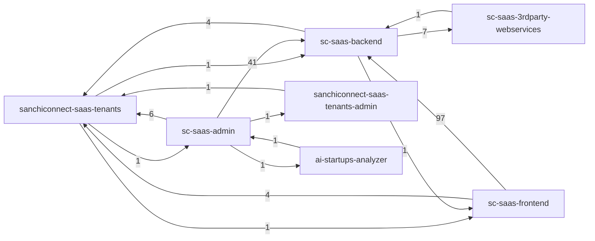

# Module map

_Generated by `scripts/generate-module-map.py` from every `module.spec.md` in the seven repos (branch `ai_native_setup`). Do not edit by hand: fix the spec and regenerate (SAN-1627)._

For each module's detail, follow its spec link or the repo's `specs/<repo>-module-specs-index.md`. The repo-level contracts and invariants are in `CLAUDE.md`.

## Summary

| Repo | Specs | Module folders without a spec | Specs with unreadable front matter |
|---|---|---|---|
| sanchiconnect-saas-tenants | 11 | 0 | 1 |
| sc-saas-backend | 70 | 0 | 0 |
| sc-saas-frontend | 86 | 1 | 4 |
| sc-saas-admin | 74 | 4 | 7 |
| sanchiconnect-saas-tenants-admin | 12 | 1 | 1 |
| ai-startups-analyzer | 1 | 2 | 1 |
| sc-saas-3rdparty-webservices | 8 | 0 | 1 |

## Repo dependencies

An arrow means modules in the first repo depend on modules in the second; the number is how many module-to-module references the specs record. Shared-database and HTTP edges are both counted.

## Cross-repo module dependencies

| From | To | Recorded in |
|---|---|---|
| admin / ai_credits | backend / voice-agent | admin_consumers |
| admin / ajax | backend / ecosystem | front matter |
| admin / application_management | analyzer / app | front matter |
| admin / application_management | backend / application-management | admin_consumers |
| admin / application_management | backend / src/modules/application-programs-management (path not found) | front matter |
| admin / application_management | backend / src/modules/programs-management (path not found) | front matter |
| admin / application_management | backend / voice-agent | admin_consumers |
| admin / application_management | backend / zenxai | admin_consumers |
| admin / auth | backend / auth | admin_consumers |
| admin / auth | backend / src/modules/admin-actions (path not found) | backend_modules |
| admin / challenges | backend / challenges | admin_consumers, backend_modules |
| admin / command_centre | tenants / subscriptions | consumers |
| admin / community-connections | backend / community-wall | admin_consumers, backend_modules |
| admin / community-connections | backend / connections | backend_modules |
| admin / content-management | backend / src/modules/content (path not found) | backend_modules |
| admin / core-bootstrap | backend / voice-agent | admin_consumers |
| admin / core-bootstrap | backend / zenxai | admin_consumers |
| admin / core-bootstrap | tenants / core-bootstrap | consumers |
| admin / events-meetings | backend / events | backend_modules |
| admin / events-meetings | backend / meetings | backend_modules |
| admin / facilities | backend / src/modules/facilities (path not found) | backend_modules |
| admin / facilities | tenants / ecosystem-facilities | consumers |
| admin / facilities | tenants / ip-management + ecosystem-facilities | consumers |
| admin / finance-memberships | backend / memberships | admin_consumers, backend_modules |
| admin / finance-memberships | backend / payment-management | admin_consumers, backend_modules |
| admin / finance_management | tenants-admin / ai_credits | backend_modules |
| admin / form-management | backend / src/modules/forms (path not found) | backend_modules |
| admin / growth-metrics | backend / milestones | backend_modules |
| admin / growth-metrics | backend / src/modules/growth-metrics (path not found) | backend_modules |
| admin / integrations | backend / ecosystem | backend_modules |
| admin / integrations | tenants / ip-management + ecosystem-facilities | consumers |
| admin / jury | backend / src/modules/application-programs-management (path not found) | front matter |
| admin / jury | backend / src/modules/programs-management (path not found) | front matter |
| admin / learning-management | backend / learning-management | admin_consumers, backend_modules |
| admin / milestones | backend / milestones | backend_counterpart |
| admin / outreach-communications | backend / src/modules/application-programs-management (path not found) | front matter |
| admin / partners-recruitment | backend / partner | admin_consumers, backend_modules |
| admin / profile_audit_logs | backend / audit-log | backend_counterpart |
| admin / program-management | backend / src/modules/mentor-application-management (path not found) | backend_modules |
| admin / program-management | backend / src/modules/programs (path not found) | backend_modules |
| admin / stakeholder-crud | backend / auth | admin_consumers |
| admin / stakeholder-crud | backend / corporate | admin_consumers |
| admin / stakeholder-crud | backend / investor | admin_consumers |
| admin / stakeholder-crud | backend / mentors | admin_consumers |
| admin / stakeholder-crud | backend / partner | admin_consumers |
| admin / stakeholder-crud | backend / startup | admin_consumers |
| admin / stakeholder-crud | tenants / ecosystem | consumers |
| admin / venture-studio | backend / application-management | admin_consumers |
| admin / venture-studio | backend / vs-programs-management | backend_modules |
| analyzer / app | admin / application_management | front matter |
| backend / ecosystem | tenants / ecosystem | consumers |
| backend / power-pitch-module | frontend / pitch-deck-management | consumed_by |
| backend / src/core/constants (no spec) | tenants / core-bootstrap | consumers |
| backend / src/core/services (no spec) | tenants / cors-domains | consumers |
| backend / src/core/services (no spec) | tenants / global | consumers |
| backend / src/core/services (no spec) | webservices / 3rdparty-webservices | consumed_by |
| backend / src/core/services (no spec) | webservices / cometChat | consumed_by |
| backend / src/core/services (no spec) | webservices / convertKit | consumed_by |
| backend / src/core/services (no spec) | webservices / sendGrid | consumed_by |
| backend / src/core/services (no spec) | webservices / ses | consumed_by |
| backend / src/core/services (no spec) | webservices / shortIo | consumed_by |
| backend / src/core/services (no spec) | webservices / videoSDK | consumed_by |
| frontend / account | backend / certificates | backend_modules |
| frontend / ad-viewer | backend / global | front matter |
| frontend / admin-actions | backend / global | backend_modules |
| frontend / auth | backend / auth | backend_modules, frontend_consumers |
| frontend / auth | backend / auth-external | frontend_consumers |
| frontend / auth | backend / global | frontend_consumers |
| frontend / calender | backend / events | backend_modules |
| frontend / calender | backend / meetings | backend_modules |
| frontend / calender | backend / mentorship | backend_modules |
| frontend / calender | backend / milestones | backend_modules |
| frontend / calender | backend / notifications | backend_modules, frontend_consumers |
| frontend / call-for-applications | backend / application-management | backend_modules |
| frontend / call-for-applications | backend / notifications | frontend_consumers |
| frontend / call-for-applications | backend / program-management | backend_modules |
| frontend / cerificates | backend / certificates | backend_modules |
| frontend / challenge-collection | backend / challenges | backend_modules |
| frontend / challenge-details | backend / challenges | backend_modules |
| frontend / challenge-details | backend / global | backend_modules |
| frontend / challenge-public-details | backend / challenges | backend_modules |
| frontend / challenge-public-details | backend / global | backend_modules |
| frontend / challenge-public-view | backend / challenges | backend_modules |
| frontend / challenge-public-view | backend / global | backend_modules |
| frontend / challenge-search | backend / challenges | backend_modules |
| frontend / challenge-search | backend / global | backend_modules |
| frontend / challenge-search | backend / notifications | backend_modules, frontend_consumers |
| frontend / challenges | backend / application-management | frontend_consumers |
| frontend / challenges | backend / challenges | backend_modules, frontend_consumers |
| frontend / challenges | backend / corporate | frontend_consumers |
| frontend / chat | backend / chat | backend_modules |
| frontend / chat | backend / conversations | backend_modules |
| frontend / community-feed | backend / community-wall | frontend_consumers |
| frontend / community-feed | backend / notifications | backend_modules, frontend_consumers |
| frontend / connection-approve-reject-page | backend / connections | backend_modules |
| frontend / connection-request-action-email | backend / auth | backend_modules |
| frontend / connection-v4 | backend / connections | backend_modules |
| frontend / connections-v3 | backend / connections | backend_modules |
| frontend / connections-v3 | backend / meetings | backend_modules |
| frontend / connections-v3 | backend / notifications | frontend_consumers |
| frontend / core | backend / auth | backend_modules |
| frontend / core | backend / global | backend_modules, frontend_consumers |
| frontend / core | backend / partner | backend_modules |
| frontend / core | tenants / core-bootstrap | consumers |
| frontend / core | tenants / global | consumers |
| frontend / corporate | backend / corporate | backend_modules, frontend_consumers |
| frontend / custom-onboarding | backend / global | backend_modules |
| frontend / dashboard | backend / dashboard | backend_modules |
| frontend / dashboard | backend / metrics | backend_modules |
| frontend / dashboard | backend / notifications | frontend_consumers |
| frontend / dashboard | backend / startup | backend_modules |
| frontend / deeptech-news | backend / global | backend_modules |
| frontend / event-agenda | backend / events | backend_modules |
| frontend / event-agenda | backend / global | backend_modules, frontend_consumers |
| frontend / external-facilities-management | backend / facility_management | backend_modules |
| frontend / facilities | backend / facility_management | backend_modules |
| frontend / facilities | tenants / ecosystem-facilities | consumers |
| frontend / glossary | backend / glossary | backend_modules |
| frontend / individual | backend / individual | backend_modules, frontend_consumers |
| frontend / individual | backend / user | backend_modules |
| frontend / investor | backend / investor | backend_modules, frontend_consumers |
| frontend / job-details | backend / meetings | backend_modules |
| frontend / job-details | backend / notifications | frontend_consumers |
| frontend / job-interview | backend / meetings | backend_modules |
| frontend / job-search | backend / global | backend_modules |
| frontend / jobs | backend / job | backend_modules, frontend_consumers |
| frontend / jobs | backend / notifications | frontend_consumers |
| frontend / learning-management | backend / learning-management | frontend_consumers |
| frontend / learning-management | backend / payment-management | frontend_consumers |
| frontend / meetings | backend / meetings | backend_modules |
| frontend / membership | backend / memberships | backend_modules |
| frontend / mentor | backend / mentors | backend_modules, frontend_consumers |
| frontend / mentor | backend / mentorship | backend_modules, frontend_consumers |
| frontend / milestones-tickets | backend / milestones | backend_modules |
| frontend / milestones-tickets | backend / tickets | backend_modules |
| frontend / notifications | backend / notifications | backend_modules, frontend_consumers |
| frontend / partner | backend / partner | backend_modules, frontend_consumers |
| frontend / partners-dashboard | backend / partner | backend_modules |
| frontend / payments | backend / memberships | backend_modules, frontend_consumers |
| frontend / payments | backend / payment-management | frontend_consumers |
| frontend / product-updates | backend / global | backend_modules |
| frontend / programs | backend / application-management | frontend_consumers |
| frontend / programs | backend / meetings | backend_modules |
| frontend / programs | backend / payment-management | frontend_consumers |
| frontend / resource-reports | backend / global | backend_modules |
| frontend / resources | backend / glossary | backend_modules |
| frontend / resources | backend / news | backend_modules |
| frontend / resources | backend / resources | backend_modules |
| frontend / resources | backend / startup | backend_modules |
| frontend / sc-certificate-renderer | backend / certificates | backend_modules |
| frontend / search | backend / ecosystem | frontend_consumers |
| frontend / search | backend / search | backend_modules, frontend_consumers |
| frontend / search | backend / user | backend_modules |
| frontend / search | tenants / ecosystem | consumers |
| frontend / service-provider | backend / service-providers | frontend_consumers |
| frontend / startup | backend / startup | backend_modules, frontend_consumers |
| frontend / startup-kit | backend / startup | backend_modules |
| frontend / team | backend / user | backend_modules |
| frontend / tickets | backend / global | backend_modules |
| frontend / tickets | backend / tickets | backend_modules |
| frontend / tracker | backend / mentorship | backend_modules |
| frontend / utilities | backend / certificates | backend_modules |
| frontend / webinars | backend / global | backend_modules |
| tenants / tenants | admin / core-bootstrap | front matter |
| tenants / tenants | backend / src/core/constants (no spec) | front matter |
| tenants / tenants | frontend / core | front matter |
| tenants-admin / cors_domain_management | tenants / cors-domains | consumers, db_access |
| webservices / sms | backend / src/core/services (no spec) | front matter |

## Feature flags by module

Tenant flags (boolean columns of `TenantUsersEntity`) and the modules whose specs say they read them. A flag with no row here is read by no specced module, or the specs don't record it.

| Flag | tenants | backend | frontend | admin | tenants-admin | analyzer | webservices |
|---|---|---|---|---|---|---|---|
| `ai_credits_enabled` |  |  |  | ai_credits |  |  |  |
| `application_management` |  |  |  | content-management, core-bootstrap, program-management |  |  |  |
| `application_video_pitch` |  |  |  | core-bootstrap |  |  |  |
| `approved_startups_can_apply_on_programs` |  | application-management, program-management | call-for-applications, programs |  |  |  |  |
| `business_challenge_collections_enabled` |  |  | challenge-collection, challenges |  |  |  |  |
| `business_challenges` |  | challenges, startup | call-for-applications, challenge-collection, challenge-public-view, challenge-search, challenges, dashboard, shared |  |  |  |  |
| `calendar` |  |  | shared |  |  |  |  |
| `call_for_applications_document_enabled` |  |  | dynamic-forms |  |  |  |  |
| `call_for_applications_payment_enabled` |  |  | dynamic-forms |  |  |  |  |
| `call_for_applications_submitted_email_enabled` |  | form-management | utilities |  |  |  |  |
| `can_deactivate_profile` |  | user | individual |  |  |  |  |
| `can_delete_profile` |  | user | individual |  |  |  |  |
| `cc_desk_communication` |  | meetings, startup-kit |  |  |  |  |  |
| `certificates` |  | certificates | account, shared, utilities | certificate_builders, certificates, memberships |  |  |  |
| `certificates_corporate` |  |  |  | certificate_builders, certificates |  |  |  |
| `certificates_investor` |  |  |  | certificate_builders, certificates |  |  |  |
| `certificates_membership` |  |  |  | certificate_builders, certificates, memberships |  |  |  |
| `certificates_mentor` |  |  |  | certificate_builders, certificates |  |  |  |
| `certificates_partner` |  |  |  | certificate_builders, certificates |  |  |  |
| `certificates_service_provider` |  |  |  | certificate_builders, certificates |  |  |  |
| `certificates_startup` |  |  |  | certificate_builders, certificates |  |  |  |
| `chat` |  | auth, chat, investor, meetings, mentors, partner, program-office-members, service-providers, startup, user | chat, meetings, shared |  |  |  |  |
| `community_feed` |  | community-wall | community-feed, shared |  |  |  |  |
| `connections` |  | connections | connection-v4, growth-matrics, shared |  |  |  |  |
| `convert_pitch_decks` |  | global |  |  |  |  |  |
| `corporates` |  | challenges, corporate, search | corporate, search |  |  |  |  |
| `cron_enabled` |  | cron |  |  |  |  |  |
| `custom_onboarding_design_enabled` |  | global | custom-onboarding | onboarding_design |  |  |  |
| `custom_smtp` |  |  |  | email_logs |  |  |  |
| `deeptech_news` |  | global | deeptech-news, resources | news |  |  |  |
| `direct_accept_connection_enabled` |  |  | connections-v3 |  |  |  |  |
| `disable_startup_profile_update` |  |  | shared |  |  |  |  |
| `ecosystem_enabled` |  | ecosystem, individual, investor, mentors, partner, program-management, program-office-members, service-providers, startup, startup-recognition-id |  | startup_recognition_management |  |  |  |
| `elastic_search` |  | cron, elastic-search | search |  |  |  |  |
| `enable_sub_industries` |  |  | program-office | core-bootstrap, stakeholder-crud |  |  |  |
| `events` |  | cron, events, notifications | calender, event-agenda |  |  |  |  |
| `events_exhibitors_menu_enabled` |  |  | partners-details |  |  |  |  |
| `external_sign_in_enabled` |  | auth-external | auth |  |  |  |  |
| `external_sign_in_server_enabled` |  | auth-external |  |  |  |  |  |
| `facility_management` |  | facility_management | external-facilities-management, facilities | facilities, finance-memberships, partners, partners-recruitment |  |  |  |
| `factacy_enabled` |  | factacy |  |  |  |  |  |
| `glossary` |  | glossary | glossary, resources |  |  |  |  |
| `growth_metrics` |  | metrics | dashboard, growth-matrics |  |  |  |  |
| `hub_spoke_domain_enabled` |  | auth, global, partner, partner-branding, partner-domain-access, program-management |  | core-bootstrap, partners |  |  |  |
| `individual_registration` |  | auth |  |  |  |  |  |
| `individuals` |  | individual, search, vs-programs-management, zoho | individual, individual-profile, search |  |  |  |  |
| `industries_technologies_section` |  | investor |  |  |  |  |  |
| `intellectual_property_section` |  |  | search | core-bootstrap, integrations |  |  |  |
| `investment_banking_section` |  |  |  | core-bootstrap |  |  |  |
| `investors` |  | investor, search | investor, search |  |  |  |  |
| `ip_management` |  | ip-management | search |  |  |  |  |
| `job_seekers` |  | auth, job | jobs |  |  |  |  |
| `job_seekers_registration` |  | auth | auth |  |  |  |  |
| `jobs` |  | job, search | applied-jobs, job-details, job-public-details, job-search, jobs, shared |  |  |  |  |
| `learning_management` |  | learning-management | learning-management | finance-memberships, learning-management |  |  |  |
| `limited_access` |  |  | individual, program-office | core-bootstrap, stakeholder-crud |  |  |  |
| `logout_on_rejection` |  |  | corporate, individual, individual-profile, mentor, partner, program-office, programs, service-provider, startup |  |  |  |  |
| `looking_for_section` |  |  |  | core-bootstrap |  |  |  |
| `meeting_moderation_enabled` |  | meetings | meetings |  |  |  |  |
| `membership_enabled` |  |  | account |  |  |  |  |
| `membership_moderation_enabled` |  |  | membership |  |  |  |  |
| `mentor_hours` |  | mentorship | mentor, tracker |  |  |  |  |
| `mentors` |  | mentors, mentorship, search | mentor, search |  |  |  |  |
| `milestone_management` |  | milestones | milestones-tickets |  |  |  |  |
| `mobile_otp_verification` |  | auth |  |  |  |  |  |
| `multiple_profiles` |  | user | individual |  |  |  |  |
| `new_dashboard_layout` |  |  | individual-profile |  |  |  |  |
| `notification_centre_enabled` |  | connections, cron, job, notifications, startup | account, calender, call-for-applications, challenge-search, community-feed, connections-v3, dashboard, job-details, jobs, notifications | broadcast_messages, command_centre, outreach_requests, task_management, tickets |  |  |  |
| `online_meetings` |  | meetings | account, meetings, shared |  |  |  |  |
| `operational_cost_reimbursement_enabled` |  | operational-cost-reimbursement | operational-cost-reimbursement | operation_cost |  |  |  |
| `partners` |  | partner, search | partner, search |  |  |  |  |
| `partners_contacts` |  |  |  | partners-recruitment |  |  |  |
| `partners_enable_dashboard` |  |  |  | partners, partners-recruitment |  |  |  |
| `partners_photo_gallery` |  |  |  | facilities, partners, partners-recruitment |  |  |  |
| `partners_program_management` |  |  |  | partners-recruitment |  |  |  |
| `partners_programs_creation_limit_enabled` |  |  |  | partners |  |  |  |
| `partners_team_management` |  |  |  | partners |  |  |  |
| `premium_modules_visibility` |  |  |  | facilities, partners, partners-recruitment |  |  |  |
| `product_updates` |  | global | account | product_updates |  |  |  |
| `profile_comparison` |  | compare |  |  |  |  |  |
| `profiles_locked` |  |  | individual |  |  |  |  |
| `program_offices` |  | program-office-members, search, zoho | program-office, search |  |  |  |  |
| `program_offices_registration` |  |  | program-office |  |  |  |  |
| `programs_payment_enabled` |  |  | call-for-applications |  |  |  |  |
| `programs_public_view` |  |  | call-for-applications, programs | core-bootstrap |  |  |  |
| `promotions_enabled` |  |  |  | partners-recruitment |  |  |  |
| `public_portal_quicklinks_file_proxy_enabled` |  | public-portal |  |  |  |  |  |
| `reports_downloads` |  | global | resource-reports | industry_reports |  |  |  |
| `resources_downloads` |  | resources | resources |  |  |  |  |
| `send_mobile_otp_login` |  | verifications |  |  |  |  |  |
| `service_kit_application_connection` |  | startup-kit | resources |  |  |  |  |
| `service_kit_stakeholder_accounts` |  |  |  | content-management, core-bootstrap, startup-booster-kit |  |  |  |
| `service_providers` |  | search, service-providers | search, service-provider |  |  |  |  |
| `single_session_login_enabled` |  | auth, sockets, user |  |  |  |  |  |
| `stakeholder_access_management_enabled` |  | individual, investor |  |  |  |  |  |
| `startup_financial_form` |  | startup | startup | core-bootstrap, csv, finance-memberships |  |  |  |
| `startup_id_cards` |  | id-cards | shared, utilities | certificates, id_card_builders, id_cards |  |  |  |
| `startup_kit` |  | startup-kit | resources, startup-kit |  |  |  |  |
| `startup_recognition_enabled` |  | program-management, startup, startup-recognition-id | account, programs | startup_recognition_management |  |  |  |
| `startup_supporting_documents` |  | startup | startup |  |  |  |  |
| `startups` |  | auth, challenges, program-management, search, startup | auth, call-for-applications, programs, search, startup | document_types, finance-memberships |  |  |  |
| `startups_company_domain_validation` |  | auth |  |  |  |  |  |
| `task_management` |  |  |  | command_centre, task_management |  |  |  |
| `ticket_management` |  | tickets | ip-request, milestones-tickets, tickets |  |  |  |  |
| `venture_studio` |  | vs-programs-management |  |  |  |  |  |
| `venture_studio_application_management` |  |  |  | venture-studio |  |  |  |
| `video_pitch_mandatory` |  |  | pitch-deck-management |  |  |  |  |
| `vs_programs_public_view` |  |  | call-for-applications, vs-programs |  |  |  |  |
| `wa_enable` |  | auth, verifications |  |  |  |  |  |
| `wa_send_messages` |  | individual, investor, mentors, partner, program-office-members, service-providers, startup, verifications |  |  |  |  |  |
| `webinar_videos` |  | global | event-agenda, programs, webinars |  |  |  |  |
| `zoho_service_enabled` |  |  |  | core-bootstrap, integrations, zoho |  |  |  |

Flags no spec mentions (125): `active`, `admin_restriction`, `ai_analyzer_enabled`, `ai_voice_agent_enabled`, `app_not_interested_types`, `application_management_check_status_section`, `application_management_invite_transfer_section`, `application_management_round_status_updates`, `application_programs_recommendation_field`, `ask_startup_to_mentor_connection_question`, `associated_partners_visibility_enabled`, `call_for_applications_analysis_enabled`, `call_for_applications_bypass_verification`, `call_for_applications_download_attachments_enabled`, `call_for_applications_download_pdfs_enabled`, `call_for_applications_download_reports_enabled`, `call_for_applications_import_applications`, `call_for_applications_mark_payment_done_enabled`, `call_for_applications_mask_info_jury`, `call_for_applications_menu_settings`, `call_for_applications_pitch_deck_enabled`, `call_for_applications_promotion_by_partner_enabled`, `call_for_applications_promotion_enabled`, `call_for_applications_promotion_with_partners_enabled`, `call_for_applications_promotion_with_tenants_enabled`, `call_for_applications_score_rating_enabled`, `call_for_applications_submission_details_in_email`, `call_for_applications_video_enabled`, `challenges_collections_filters_enabled`, `company_identification_cin`, `company_identification_dpiit`, `company_identification_gst`, `connection_request_limit_enabled`, `corporate_backdoor_login_enabled`, `corporate_profile_registration_confirmation_enabled`, `corporates_enagement_form`, `corporates_registration`, `custom_forms`, `custom_forms_filters`, `custom_onboarding_design_golive_enabled`, `custom_reporting`, `dashboard_plan_info`, `domain_based_restriction`, `email_otp_verification`, `enable_file_viewer`, `events_agenda_menu_enabled`, `events_notifications`, `events_one_to_one_feature`, `events_payment_enabled`, `events_questions`, `facility_enable_admin_booking_creation`, `facility_enable_admin_facility_creation`, `facility_enable_checkin_checkout`, `facility_enable_pricing`, `facility_enable_ratings`, `facility_hourly_basis_booking_enabled`, `filing_email_address_enabled`, `form_video_transcript_enabled`, `frontend_restriction`, `government`, `growth_metrics_duration_set`, `has_pp_partner_account`, `incubator_module_enabled`, `individual_investor`, `investor_pitch_deck_access_enabled`, `investors_registration`, `ip_based_restriction`, `is_facility_hub`, `is_patent_hub`, `jury_nda_enabled`, `jury_questions`, `limit_jury_access_enabled`, `meeting_feedback_enabled`, `membership_certificate_generation_enabled`, `mentor_application_management`, `mentor_domain_expertise_tab`, `mentorship_areas_new_layout`, `new_search_layout`, `partner_visibility_requests_enabled`, `partners_can_add_booking`, `partners_can_invite_stakeholders`, `partners_enable_ecosystem`, `partners_enable_jury_in_app_management`, `partners_enable_qna_in_app_management`, `partners_facility_enable_checkin_checkout`, `partners_ip_management`, `partners_registration`, `post_revenue_fields`, `powerpitch_transcript_enabled`, `primary_industry`, `program_management_with_profile_form`, `program_timeline_enabled`, `programs_document_enabled`, `programs_mark_payment_done_enabled`, `programs_menu_enabled`, `programs_score_rating_enabled`, `programs_video_enabled`, `promotions_partners_enabled`, `public_portal_api_enabled`, `registration_enterprise_sales_popup`, `registration_invite_only`, `registration_turnoff_programs`, `request_call_jury`, `service_providers_registration`, `short_links`, `show_dashboard`, `show_documents_to_jury`, `show_ecosystem`, `spoke_stakeholders_meeting_moderation_enabled`, `sso_login_enabled`, `startup_approval_email_to_investors`, `startup_city_enabled`, `startup_district_subdistrict_enabled`, `startup_founders_advisory`, `startup_grant_release_format_download_enable`, `startup_kit_parallel_email`, `startup_onboarding_modal`, `startup_programs_recommendation_field`, `startup_show_programs`, `startups_registration`, `syndicate`, `tripura_certificate_theme_enabled`, `venture_studio_can_close_program`, `venture_studio_team_formation`, `whatsapp_otp_verification`

## Module inventory

### sanchiconnect-saas-tenants

| Module | Status | Updated | Depends on (other repos) | Spec |
|---|---|---|---|---|
| core-bootstrap | draft | 2026-10-07 |  | [src/core/module.spec.md](https://github.com/sanchiconnect-org/sanchiconnect-saas-tenants/blob/ai_native_setup/src/core/module.spec.md) |
| ai-credits | draft | 2026-09-29 |  | [src/modules/ai-credits/module.spec.md](https://github.com/sanchiconnect-org/sanchiconnect-saas-tenants/blob/ai_native_setup/src/modules/ai-credits/module.spec.md) |
| cors-domains | draft | 2026-08-20 |  | [src/modules/cors-domains/module.spec.md](https://github.com/sanchiconnect-org/sanchiconnect-saas-tenants/blob/ai_native_setup/src/modules/cors-domains/module.spec.md) |
| domain-orchestration | draft | 2026-08-20 |  | [src/modules/domain-orchestration/module.spec.md](https://github.com/sanchiconnect-org/sanchiconnect-saas-tenants/blob/ai_native_setup/src/modules/domain-orchestration/module.spec.md) |
| ecosystem | draft | 2026-06-18 |  | [src/modules/ecosystem/module.spec.md](https://github.com/sanchiconnect-org/sanchiconnect-saas-tenants/blob/ai_native_setup/src/modules/ecosystem/module.spec.md) |
| ecosystem-facilities | draft | 2026-06-18 |  | [src/modules/ecosystem-facilities/module.spec.md](https://github.com/sanchiconnect-org/sanchiconnect-saas-tenants/blob/ai_native_setup/src/modules/ecosystem-facilities/module.spec.md) |
| global | draft | 2026-10-07 |  | [src/modules/global/module.spec.md](https://github.com/sanchiconnect-org/sanchiconnect-saas-tenants/blob/ai_native_setup/src/modules/global/module.spec.md) |
| ip-management + ecosystem-facilities | draft | 2026-07-16 |  | [src/modules/ip-management/module.spec.md](https://github.com/sanchiconnect-org/sanchiconnect-saas-tenants/blob/ai_native_setup/src/modules/ip-management/module.spec.md) |
| organizations | draft | 2026-07-16 |  | [src/modules/organizations/module.spec.md](https://github.com/sanchiconnect-org/sanchiconnect-saas-tenants/blob/ai_native_setup/src/modules/organizations/module.spec.md) |
| subscriptions | draft | 2026-06-18 |  | [src/modules/subscriptions/module.spec.md](https://github.com/sanchiconnect-org/sanchiconnect-saas-tenants/blob/ai_native_setup/src/modules/subscriptions/module.spec.md) |
| tenants | ? |  | admin/core-bootstrap, backend/src/core/constants (no spec), frontend/core | [src/modules/tenants/module.spec.md](https://github.com/sanchiconnect-org/sanchiconnect-saas-tenants/blob/ai_native_setup/src/modules/tenants/module.spec.md) |

### sc-saas-backend

| Module | Status | Updated | Depends on (other repos) | Spec |
|---|---|---|---|---|
| sockets | draft | 2026-10-13 |  | [src/core/sockets/module.spec.md](https://github.com/sanchiconnect-org/sc-saas-backend/blob/ai_native_setup/src/core/sockets/module.spec.md) |
| upload-module | draft | 2026-10-07 |  | [src/core/upload-module/module.spec.md](https://github.com/sanchiconnect-org/sc-saas-backend/blob/ai_native_setup/src/core/upload-module/module.spec.md) |
| voice-agent | in-review | 2026-10-06 |  | [src/core/voice-agent/module.spec.md](https://github.com/sanchiconnect-org/sc-saas-backend/blob/ai_native_setup/src/core/voice-agent/module.spec.md) |
| zenxai | in-review | 2026-09-29 |  | [src/core/zenxai/module.spec.md](https://github.com/sanchiconnect-org/sc-saas-backend/blob/ai_native_setup/src/core/zenxai/module.spec.md) |
| zoho | draft | 2026-07-17 |  | [src/core/zoho/module.spec.md](https://github.com/sanchiconnect-org/sc-saas-backend/blob/ai_native_setup/src/core/zoho/module.spec.md) |
| application-management | draft | 2026-10-08 |  | [src/modules/application-management/module.spec.md](https://github.com/sanchiconnect-org/sc-saas-backend/blob/ai_native_setup/src/modules/application-management/module.spec.md) |
| audit-log | draft | 2026-06-17 |  | [src/modules/audit-log/module.spec.md](https://github.com/sanchiconnect-org/sc-saas-backend/blob/ai_native_setup/src/modules/audit-log/module.spec.md) |
| auth | draft | 2026-07-16 |  | [src/modules/auth/module.spec.md](https://github.com/sanchiconnect-org/sc-saas-backend/blob/ai_native_setup/src/modules/auth/module.spec.md) |
| auth-external | draft | 2026-06-17 |  | [src/modules/auth-external/module.spec.md](https://github.com/sanchiconnect-org/sc-saas-backend/blob/ai_native_setup/src/modules/auth-external/module.spec.md) |
| certificates | draft | 2026-09-23 |  | [src/modules/certificates/module.spec.md](https://github.com/sanchiconnect-org/sc-saas-backend/blob/ai_native_setup/src/modules/certificates/module.spec.md) |
| challenges | draft | 2026-06-17 |  | [src/modules/challenges/module.spec.md](https://github.com/sanchiconnect-org/sc-saas-backend/blob/ai_native_setup/src/modules/challenges/module.spec.md) |
| chat | draft | 2026-06-17 |  | [src/modules/chat/module.spec.md](https://github.com/sanchiconnect-org/sc-saas-backend/blob/ai_native_setup/src/modules/chat/module.spec.md) |
| community-wall | draft | 2026-07-16 |  | [src/modules/community-wall/module.spec.md](https://github.com/sanchiconnect-org/sc-saas-backend/blob/ai_native_setup/src/modules/community-wall/module.spec.md) |
| compare | draft | 2026-07-16 |  | [src/modules/compare/module.spec.md](https://github.com/sanchiconnect-org/sc-saas-backend/blob/ai_native_setup/src/modules/compare/module.spec.md) |
| connections | draft | 2026-10-12 |  | [src/modules/connections/module.spec.md](https://github.com/sanchiconnect-org/sc-saas-backend/blob/ai_native_setup/src/modules/connections/module.spec.md) |
| connections-wishlist | draft | 2026-06-17 |  | [src/modules/connections-wishlist/module.spec.md](https://github.com/sanchiconnect-org/sc-saas-backend/blob/ai_native_setup/src/modules/connections-wishlist/module.spec.md) |
| consent | in-review | 2026-10-13 |  | [src/modules/consent/module.spec.md](https://github.com/sanchiconnect-org/sc-saas-backend/blob/ai_native_setup/src/modules/consent/module.spec.md) |
| conversations | draft | 2026-06-17 |  | [src/modules/conversations/module.spec.md](https://github.com/sanchiconnect-org/sc-saas-backend/blob/ai_native_setup/src/modules/conversations/module.spec.md) |
| corporate | draft | 2026-10-12 |  | [src/modules/corporate/module.spec.md](https://github.com/sanchiconnect-org/sc-saas-backend/blob/ai_native_setup/src/modules/corporate/module.spec.md) |
| cron | draft | 2026-10-12 |  | [src/modules/cron/module.spec.md](https://github.com/sanchiconnect-org/sc-saas-backend/blob/ai_native_setup/src/modules/cron/module.spec.md) |
| dashboard | draft | 2026-10-12 |  | [src/modules/dashboard/module.spec.md](https://github.com/sanchiconnect-org/sc-saas-backend/blob/ai_native_setup/src/modules/dashboard/module.spec.md) |
| ecosystem | draft | 2026-06-17 | tenants/ecosystem | [src/modules/ecosystem/module.spec.md](https://github.com/sanchiconnect-org/sc-saas-backend/blob/ai_native_setup/src/modules/ecosystem/module.spec.md) |
| elastic-search | draft | 2026-06-17 |  | [src/modules/elastic-search/module.spec.md](https://github.com/sanchiconnect-org/sc-saas-backend/blob/ai_native_setup/src/modules/elastic-search/module.spec.md) |
| events | draft | 2026-10-08 |  | [src/modules/events/module.spec.md](https://github.com/sanchiconnect-org/sc-saas-backend/blob/ai_native_setup/src/modules/events/module.spec.md) |
| facility_management | draft | 2026-07-16 |  | [src/modules/facility_management/module.spec.md](https://github.com/sanchiconnect-org/sc-saas-backend/blob/ai_native_setup/src/modules/facility_management/module.spec.md) |
| factacy | draft | 2026-06-17 |  | [src/modules/factacy/module.spec.md](https://github.com/sanchiconnect-org/sc-saas-backend/blob/ai_native_setup/src/modules/factacy/module.spec.md) |
| form-management | draft | 2026-06-17 |  | [src/modules/form-management/module.spec.md](https://github.com/sanchiconnect-org/sc-saas-backend/blob/ai_native_setup/src/modules/form-management/module.spec.md) |
| global | draft | 2026-09-24 |  | [src/modules/global/module.spec.md](https://github.com/sanchiconnect-org/sc-saas-backend/blob/ai_native_setup/src/modules/global/module.spec.md) |
| glossary | draft | 2026-06-17 |  | [src/modules/glossary/module.spec.md](https://github.com/sanchiconnect-org/sc-saas-backend/blob/ai_native_setup/src/modules/glossary/module.spec.md) |
| grants | draft | 2026-06-17 |  | [src/modules/grants/module.spec.md](https://github.com/sanchiconnect-org/sc-saas-backend/blob/ai_native_setup/src/modules/grants/module.spec.md) |
| id-cards | draft | 2026-06-17 |  | [src/modules/id-cards/module.spec.md](https://github.com/sanchiconnect-org/sc-saas-backend/blob/ai_native_setup/src/modules/id-cards/module.spec.md) |
| import | draft | 2026-07-16 |  | [src/modules/import/module.spec.md](https://github.com/sanchiconnect-org/sc-saas-backend/blob/ai_native_setup/src/modules/import/module.spec.md) |
| individual | draft | 2026-10-07 |  | [src/modules/individual/module.spec.md](https://github.com/sanchiconnect-org/sc-saas-backend/blob/ai_native_setup/src/modules/individual/module.spec.md) |
| investor | draft | 2026-10-08 |  | [src/modules/investor/module.spec.md](https://github.com/sanchiconnect-org/sc-saas-backend/blob/ai_native_setup/src/modules/investor/module.spec.md) |
| invoice | draft | 2026-06-17 |  | [src/modules/invoice/module.spec.md](https://github.com/sanchiconnect-org/sc-saas-backend/blob/ai_native_setup/src/modules/invoice/module.spec.md) |
| ip-management | draft | 2026-06-17 |  | [src/modules/ip-management/module.spec.md](https://github.com/sanchiconnect-org/sc-saas-backend/blob/ai_native_setup/src/modules/ip-management/module.spec.md) |
| job | draft | 2026-10-08 |  | [src/modules/job/module.spec.md](https://github.com/sanchiconnect-org/sc-saas-backend/blob/ai_native_setup/src/modules/job/module.spec.md) |
| jury-nda | in-progress | 2026-10-01 |  | [src/modules/jury-nda/module.spec.md](https://github.com/sanchiconnect-org/sc-saas-backend/blob/ai_native_setup/src/modules/jury-nda/module.spec.md) |
| learning-management | draft | 2026-06-17 |  | [src/modules/learning-management/module.spec.md](https://github.com/sanchiconnect-org/sc-saas-backend/blob/ai_native_setup/src/modules/learning-management/module.spec.md) |
| meetings | draft | 2026-10-12 |  | [src/modules/meetings/module.spec.md](https://github.com/sanchiconnect-org/sc-saas-backend/blob/ai_native_setup/src/modules/meetings/module.spec.md) |
| memberships | draft | 2026-07-16 |  | [src/modules/memberships/module.spec.md](https://github.com/sanchiconnect-org/sc-saas-backend/blob/ai_native_setup/src/modules/memberships/module.spec.md) |
| mentors | draft | 2026-10-08 |  | [src/modules/mentors/module.spec.md](https://github.com/sanchiconnect-org/sc-saas-backend/blob/ai_native_setup/src/modules/mentors/module.spec.md) |
| mentorship | draft | 2026-07-16 |  | [src/modules/mentorship/module.spec.md](https://github.com/sanchiconnect-org/sc-saas-backend/blob/ai_native_setup/src/modules/mentorship/module.spec.md) |
| metrics | draft | 2026-06-17 |  | [src/modules/metrics/module.spec.md](https://github.com/sanchiconnect-org/sc-saas-backend/blob/ai_native_setup/src/modules/metrics/module.spec.md) |
| migrations | draft | 2026-07-16 |  | [src/modules/migrations/module.spec.md](https://github.com/sanchiconnect-org/sc-saas-backend/blob/ai_native_setup/src/modules/migrations/module.spec.md) |
| milestones | draft | 2026-06-17 |  | [src/modules/milestones/module.spec.md](https://github.com/sanchiconnect-org/sc-saas-backend/blob/ai_native_setup/src/modules/milestones/module.spec.md) |
| news | draft | 2026-07-16 |  | [src/modules/news/module.spec.md](https://github.com/sanchiconnect-org/sc-saas-backend/blob/ai_native_setup/src/modules/news/module.spec.md) |
| notifications | approved | 2026-10-08 |  | [src/modules/notifications/module.spec.md](https://github.com/sanchiconnect-org/sc-saas-backend/blob/ai_native_setup/src/modules/notifications/module.spec.md) |
| operational-cost-reimbursement | in-review | 2026-09-15 |  | [src/modules/operational-cost-reimbursement/module.spec.md](https://github.com/sanchiconnect-org/sc-saas-backend/blob/ai_native_setup/src/modules/operational-cost-reimbursement/module.spec.md) |
| partner | draft | 2026-10-07 |  | [src/modules/partner/module.spec.md](https://github.com/sanchiconnect-org/sc-saas-backend/blob/ai_native_setup/src/modules/partner/module.spec.md) |
| partner-branding | in-review | 2026-08-20 |  | [src/modules/partner-branding/module.spec.md](https://github.com/sanchiconnect-org/sc-saas-backend/blob/ai_native_setup/src/modules/partner-branding/module.spec.md) |
| partner-domain-access | in-review | 2026-08-20 |  | [src/modules/partner-domain-access/module.spec.md](https://github.com/sanchiconnect-org/sc-saas-backend/blob/ai_native_setup/src/modules/partner-domain-access/module.spec.md) |
| payment-management | draft | 2026-06-17 |  | [src/modules/payment-management/module.spec.md](https://github.com/sanchiconnect-org/sc-saas-backend/blob/ai_native_setup/src/modules/payment-management/module.spec.md) |
| portfolio-management | draft | 2026-06-17 |  | [src/modules/portfolio-management/module.spec.md](https://github.com/sanchiconnect-org/sc-saas-backend/blob/ai_native_setup/src/modules/portfolio-management/module.spec.md) |
| power-pitch-module | draft | 2026-06-19 | frontend/pitch-deck-management | [src/modules/power-pitch-module/module.spec.md](https://github.com/sanchiconnect-org/sc-saas-backend/blob/ai_native_setup/src/modules/power-pitch-module/module.spec.md) |
| program-management | draft | 2026-10-08 |  | [src/modules/program-management/module.spec.md](https://github.com/sanchiconnect-org/sc-saas-backend/blob/ai_native_setup/src/modules/program-management/module.spec.md) |
| program-office-members | draft | 2026-10-07 |  | [src/modules/program-office-members/module.spec.md](https://github.com/sanchiconnect-org/sc-saas-backend/blob/ai_native_setup/src/modules/program-office-members/module.spec.md) |
| public-portal | draft | 2026-09-09 |  | [src/modules/public-portal/module.spec.md](https://github.com/sanchiconnect-org/sc-saas-backend/blob/ai_native_setup/src/modules/public-portal/module.spec.md) |
| resources | draft | 2026-06-17 |  | [src/modules/resources/module.spec.md](https://github.com/sanchiconnect-org/sc-saas-backend/blob/ai_native_setup/src/modules/resources/module.spec.md) |
| schemes-management | draft | 2026-09-14 |  | [src/modules/schemes-management/module.spec.md](https://github.com/sanchiconnect-org/sc-saas-backend/blob/ai_native_setup/src/modules/schemes-management/module.spec.md) |
| search | draft | 2026-08-27 |  | [src/modules/search/module.spec.md](https://github.com/sanchiconnect-org/sc-saas-backend/blob/ai_native_setup/src/modules/search/module.spec.md) |
| service-providers | draft | 2026-10-07 |  | [src/modules/service-providers/module.spec.md](https://github.com/sanchiconnect-org/sc-saas-backend/blob/ai_native_setup/src/modules/service-providers/module.spec.md) |
| startup | draft | 2026-10-08 |  | [src/modules/startup/module.spec.md](https://github.com/sanchiconnect-org/sc-saas-backend/blob/ai_native_setup/src/modules/startup/module.spec.md) |
| startup-kit | draft | 2026-07-16 |  | [src/modules/startup-kit/module.spec.md](https://github.com/sanchiconnect-org/sc-saas-backend/blob/ai_native_setup/src/modules/startup-kit/module.spec.md) |
| startup-recognition-id | draft | 2026-08-13 |  | [src/modules/startup-recognition-id/module.spec.md](https://github.com/sanchiconnect-org/sc-saas-backend/blob/ai_native_setup/src/modules/startup-recognition-id/module.spec.md) |
| task-management | draft | 2026-06-17 |  | [src/modules/task-management/module.spec.md](https://github.com/sanchiconnect-org/sc-saas-backend/blob/ai_native_setup/src/modules/task-management/module.spec.md) |
| tickets | draft | 2026-07-16 |  | [src/modules/tickets/module.spec.md](https://github.com/sanchiconnect-org/sc-saas-backend/blob/ai_native_setup/src/modules/tickets/module.spec.md) |
| user | draft | 2026-10-12 |  | [src/modules/user/module.spec.md](https://github.com/sanchiconnect-org/sc-saas-backend/blob/ai_native_setup/src/modules/user/module.spec.md) |
| verifications | draft | 2026-07-16 |  | [src/modules/verifications/module.spec.md](https://github.com/sanchiconnect-org/sc-saas-backend/blob/ai_native_setup/src/modules/verifications/module.spec.md) |
| vs-programs-management | draft | 2026-10-08 |  | [src/modules/vs-programs-management/module.spec.md](https://github.com/sanchiconnect-org/sc-saas-backend/blob/ai_native_setup/src/modules/vs-programs-management/module.spec.md) |

### sc-saas-frontend

| Module | Status | Updated | Depends on (other repos) | Spec |
|---|---|---|---|---|
| core | draft | 2026-08-19 | backend/auth, backend/global, backend/partner, tenants/core-bootstrap, tenants/global | [src/app/core/module.spec.md](https://github.com/sanchiconnect-org/sc-saas-frontend/blob/ai_native_setup/src/app/core/module.spec.md) |
| account | draft | 2026-10-07 | backend/certificates | [src/app/modules/account/module.spec.md](https://github.com/sanchiconnect-org/sc-saas-frontend/blob/ai_native_setup/src/app/modules/account/module.spec.md) |
| ad-viewer | ? |  | backend/global | [src/app/modules/ad-viewer/module.spec.md](https://github.com/sanchiconnect-org/sc-saas-frontend/blob/ai_native_setup/src/app/modules/ad-viewer/module.spec.md) |
| admin-actions | draft | 2026-07-19 | backend/global | [src/app/modules/admin-actions/module.spec.md](https://github.com/sanchiconnect-org/sc-saas-frontend/blob/ai_native_setup/src/app/modules/admin-actions/module.spec.md) |
| applied-jobs | draft | 2026-07-19 |  | [src/app/modules/applied-jobs/module.spec.md](https://github.com/sanchiconnect-org/sc-saas-frontend/blob/ai_native_setup/src/app/modules/applied-jobs/module.spec.md) |
| auth | draft | 2026-08-20 | backend/auth, backend/auth-external, backend/global | [src/app/modules/auth/module.spec.md](https://github.com/sanchiconnect-org/sc-saas-frontend/blob/ai_native_setup/src/app/modules/auth/module.spec.md) |
| calender | draft | 2026-10-08 | backend/events, backend/meetings, backend/mentorship, backend/milestones, backend/notifications | [src/app/modules/calender/module.spec.md](https://github.com/sanchiconnect-org/sc-saas-frontend/blob/ai_native_setup/src/app/modules/calender/module.spec.md) |
| call-for-applications | approved | 2026-10-08 | backend/application-management, backend/notifications, backend/program-management | [src/app/modules/call-for-applications/module.spec.md](https://github.com/sanchiconnect-org/sc-saas-frontend/blob/ai_native_setup/src/app/modules/call-for-applications/module.spec.md) |
| cerificates | draft | 2026-07-19 | backend/certificates | [src/app/modules/cerificates/module.spec.md](https://github.com/sanchiconnect-org/sc-saas-frontend/blob/ai_native_setup/src/app/modules/cerificates/module.spec.md) |
| challenge-collection | draft | 2026-07-19 | backend/challenges | [src/app/modules/challenge-collection/module.spec.md](https://github.com/sanchiconnect-org/sc-saas-frontend/blob/ai_native_setup/src/app/modules/challenge-collection/module.spec.md) |
| challenge-details | draft | 2026-07-19 | backend/challenges, backend/global | [src/app/modules/challenge-details/module.spec.md](https://github.com/sanchiconnect-org/sc-saas-frontend/blob/ai_native_setup/src/app/modules/challenge-details/module.spec.md) |
| challenge-public-details | draft | 2026-07-19 | backend/challenges, backend/global | [src/app/modules/challenge-public-details/module.spec.md](https://github.com/sanchiconnect-org/sc-saas-frontend/blob/ai_native_setup/src/app/modules/challenge-public-details/module.spec.md) |
| challenge-public-view | draft | 2026-07-19 | backend/challenges, backend/global | [src/app/modules/challenge-public-view/module.spec.md](https://github.com/sanchiconnect-org/sc-saas-frontend/blob/ai_native_setup/src/app/modules/challenge-public-view/module.spec.md) |
| challenge-search | draft | 2026-10-08 | backend/challenges, backend/global, backend/notifications | [src/app/modules/challenge-search/module.spec.md](https://github.com/sanchiconnect-org/sc-saas-frontend/blob/ai_native_setup/src/app/modules/challenge-search/module.spec.md) |
| challenges | draft | 2026-06-17 | backend/application-management, backend/challenges, backend/corporate | [src/app/modules/challenges/module.spec.md](https://github.com/sanchiconnect-org/sc-saas-frontend/blob/ai_native_setup/src/app/modules/challenges/module.spec.md) |
| chat | draft | 2026-07-16 | backend/chat, backend/conversations | [src/app/modules/chat/module.spec.md](https://github.com/sanchiconnect-org/sc-saas-frontend/blob/ai_native_setup/src/app/modules/chat/module.spec.md) |
| community-feed | draft | 2026-10-08 | backend/community-wall, backend/notifications | [src/app/modules/community-feed/module.spec.md](https://github.com/sanchiconnect-org/sc-saas-frontend/blob/ai_native_setup/src/app/modules/community-feed/module.spec.md) |
| connection-approve-reject-page | draft | 2026-07-19 | backend/connections | [src/app/modules/connection-approve-reject-page/module.spec.md](https://github.com/sanchiconnect-org/sc-saas-frontend/blob/ai_native_setup/src/app/modules/connection-approve-reject-page/module.spec.md) |
| connection-request-action-email | draft | 2026-07-19 | backend/auth | [src/app/modules/connection-request-action-email/module.spec.md](https://github.com/sanchiconnect-org/sc-saas-frontend/blob/ai_native_setup/src/app/modules/connection-request-action-email/module.spec.md) |
| connection-v4 | draft | 2026-07-16 | backend/connections | [src/app/modules/connection-v4/module.spec.md](https://github.com/sanchiconnect-org/sc-saas-frontend/blob/ai_native_setup/src/app/modules/connection-v4/module.spec.md) |
| connections | draft | 2026-07-19 |  | [src/app/modules/connections/module.spec.md](https://github.com/sanchiconnect-org/sc-saas-frontend/blob/ai_native_setup/src/app/modules/connections/module.spec.md) |
| connections-v3 | draft | 2026-10-08 | backend/connections, backend/meetings, backend/notifications | [src/app/modules/connections-v3/module.spec.md](https://github.com/sanchiconnect-org/sc-saas-frontend/blob/ai_native_setup/src/app/modules/connections-v3/module.spec.md) |
| corporate | draft | 2026-10-07 | backend/corporate | [src/app/modules/corporate/module.spec.md](https://github.com/sanchiconnect-org/sc-saas-frontend/blob/ai_native_setup/src/app/modules/corporate/module.spec.md) |
| custom-onboarding | draft | 2026-08-06 | backend/global | [src/app/modules/custom-onboarding/module.spec.md](https://github.com/sanchiconnect-org/sc-saas-frontend/blob/ai_native_setup/src/app/modules/custom-onboarding/module.spec.md) |
| dashboard | draft | 2026-10-08 | backend/dashboard, backend/metrics, backend/notifications, backend/startup | [src/app/modules/dashboard-v2/module.spec.md](https://github.com/sanchiconnect-org/sc-saas-frontend/blob/ai_native_setup/src/app/modules/dashboard-v2/module.spec.md) |
| deeptech-news | draft | 2026-07-19 | backend/global | [src/app/modules/deeptech-news/module.spec.md](https://github.com/sanchiconnect-org/sc-saas-frontend/blob/ai_native_setup/src/app/modules/deeptech-news/module.spec.md) |
| dynamic-forms | draft | 2026-10-07 |  | [src/app/modules/dynamic-forms/module.spec.md](https://github.com/sanchiconnect-org/sc-saas-frontend/blob/ai_native_setup/src/app/modules/dynamic-forms/module.spec.md) |
| event-agenda | draft | 2026-07-16 | backend/events, backend/global | [src/app/modules/event-agenda/module.spec.md](https://github.com/sanchiconnect-org/sc-saas-frontend/blob/ai_native_setup/src/app/modules/event-agenda/module.spec.md) |
| external-facilities-management | draft | 2026-07-19 | backend/facility_management | [src/app/modules/external-facilities-management/module.spec.md](https://github.com/sanchiconnect-org/sc-saas-frontend/blob/ai_native_setup/src/app/modules/external-facilities-management/module.spec.md) |
| facilities | draft | 2026-07-16 | backend/facility_management, tenants/ecosystem-facilities | [src/app/modules/facilities-management/module.spec.md](https://github.com/sanchiconnect-org/sc-saas-frontend/blob/ai_native_setup/src/app/modules/facilities-management/module.spec.md) |
| global-search-page | ? |  |  | [src/app/modules/global-search-page/module.spec.md](https://github.com/sanchiconnect-org/sc-saas-frontend/blob/ai_native_setup/src/app/modules/global-search-page/module.spec.md) |
| glossary | draft | 2026-07-19 | backend/glossary | [src/app/modules/glossary/module.spec.md](https://github.com/sanchiconnect-org/sc-saas-frontend/blob/ai_native_setup/src/app/modules/glossary/module.spec.md) |
| growth-matrics | draft | 2026-10-07 |  | [src/app/modules/growth-matrics/module.spec.md](https://github.com/sanchiconnect-org/sc-saas-frontend/blob/ai_native_setup/src/app/modules/growth-matrics/module.spec.md) |
| growth-matrics-print | draft | 2026-07-19 |  | [src/app/modules/growth-matrics-print/module.spec.md](https://github.com/sanchiconnect-org/sc-saas-frontend/blob/ai_native_setup/src/app/modules/growth-matrics-print/module.spec.md) |
| jobs | draft | 2026-10-08 | backend/job, backend/notifications | [src/app/modules/hire/module.spec.md](https://github.com/sanchiconnect-org/sc-saas-frontend/blob/ai_native_setup/src/app/modules/hire/module.spec.md) |
| individual-profile | draft | 2026-10-07 |  | [src/app/modules/individual-profile/module.spec.md](https://github.com/sanchiconnect-org/sc-saas-frontend/blob/ai_native_setup/src/app/modules/individual-profile/module.spec.md) |
| individual | draft | 2026-07-16 | backend/individual, backend/user | [src/app/modules/individuals/module.spec.md](https://github.com/sanchiconnect-org/sc-saas-frontend/blob/ai_native_setup/src/app/modules/individuals/module.spec.md) |
| inline-styles-csp | draft | 2026-07-19 |  | [src/app/modules/inline-styles-csp/module.spec.md](https://github.com/sanchiconnect-org/sc-saas-frontend/blob/ai_native_setup/src/app/modules/inline-styles-csp/module.spec.md) |
| investor | draft | 2026-10-07 | backend/investor | [src/app/modules/investors/module.spec.md](https://github.com/sanchiconnect-org/sc-saas-frontend/blob/ai_native_setup/src/app/modules/investors/module.spec.md) |
| ip-request | draft | 2026-07-19 |  | [src/app/modules/ip-request/module.spec.md](https://github.com/sanchiconnect-org/sc-saas-frontend/blob/ai_native_setup/src/app/modules/ip-request/module.spec.md) |
| ip-search | draft | 2026-07-19 |  | [src/app/modules/ip-search/module.spec.md](https://github.com/sanchiconnect-org/sc-saas-frontend/blob/ai_native_setup/src/app/modules/ip-search/module.spec.md) |
| job-details | draft | 2026-10-08 | backend/meetings, backend/notifications | [src/app/modules/job-details/module.spec.md](https://github.com/sanchiconnect-org/sc-saas-frontend/blob/ai_native_setup/src/app/modules/job-details/module.spec.md) |
| job-interview | draft | 2026-07-19 | backend/meetings | [src/app/modules/job-interview/module.spec.md](https://github.com/sanchiconnect-org/sc-saas-frontend/blob/ai_native_setup/src/app/modules/job-interview/module.spec.md) |
| job-public-details | draft | 2026-07-19 |  | [src/app/modules/job-public-details/module.spec.md](https://github.com/sanchiconnect-org/sc-saas-frontend/blob/ai_native_setup/src/app/modules/job-public-details/module.spec.md) |
| job-search | draft | 2026-07-19 | backend/global | [src/app/modules/job-search/module.spec.md](https://github.com/sanchiconnect-org/sc-saas-frontend/blob/ai_native_setup/src/app/modules/job-search/module.spec.md) |
| learning-management | draft | 2026-07-16 | backend/learning-management, backend/payment-management | [src/app/modules/learning-management/module.spec.md](https://github.com/sanchiconnect-org/sc-saas-frontend/blob/ai_native_setup/src/app/modules/learning-management/module.spec.md) |
| market-insights | draft | 2026-07-19 |  | [src/app/modules/market-insights/module.spec.md](https://github.com/sanchiconnect-org/sc-saas-frontend/blob/ai_native_setup/src/app/modules/market-insights/module.spec.md) |
| meetings | draft | 2026-07-16 | backend/meetings | [src/app/modules/meetings/module.spec.md](https://github.com/sanchiconnect-org/sc-saas-frontend/blob/ai_native_setup/src/app/modules/meetings/module.spec.md) |
| membership | draft | 2026-07-19 | backend/memberships | [src/app/modules/membership/module.spec.md](https://github.com/sanchiconnect-org/sc-saas-frontend/blob/ai_native_setup/src/app/modules/membership/module.spec.md) |
| mentor | draft | 2026-10-07 | backend/mentors, backend/mentorship | [src/app/modules/mentors/module.spec.md](https://github.com/sanchiconnect-org/sc-saas-frontend/blob/ai_native_setup/src/app/modules/mentors/module.spec.md) |
| milestones-tickets | draft | 2026-07-16 | backend/milestones, backend/tickets | [src/app/modules/milestones/module.spec.md](https://github.com/sanchiconnect-org/sc-saas-frontend/blob/ai_native_setup/src/app/modules/milestones/module.spec.md) |
| notifications | approved | 2026-10-08 | backend/notifications | [src/app/modules/notifications/module.spec.md](https://github.com/sanchiconnect-org/sc-saas-frontend/blob/ai_native_setup/src/app/modules/notifications/module.spec.md) |
| operational-cost-reimbursement | in-review | 2026-09-15 |  | [src/app/modules/operational-cost-reimbursement/module.spec.md](https://github.com/sanchiconnect-org/sc-saas-frontend/blob/ai_native_setup/src/app/modules/operational-cost-reimbursement/module.spec.md) |
| page-not-found | draft | 2026-07-19 |  | [src/app/modules/page-not-found/module.spec.md](https://github.com/sanchiconnect-org/sc-saas-frontend/blob/ai_native_setup/src/app/modules/page-not-found/module.spec.md) |
| partner | draft | 2026-07-16 | backend/partner | [src/app/modules/partners/module.spec.md](https://github.com/sanchiconnect-org/sc-saas-frontend/blob/ai_native_setup/src/app/modules/partners/module.spec.md) |
| partners-dashboard | draft | 2026-08-24 | backend/partner | [src/app/modules/partners-dashboard/module.spec.md](https://github.com/sanchiconnect-org/sc-saas-frontend/blob/ai_native_setup/src/app/modules/partners-dashboard/module.spec.md) |
| partners-details | draft | 2026-10-07 |  | [src/app/modules/partners-details/module.spec.md](https://github.com/sanchiconnect-org/sc-saas-frontend/blob/ai_native_setup/src/app/modules/partners-details/module.spec.md) |
| payments | draft | 2026-07-16 | backend/memberships, backend/payment-management | [src/app/modules/payment/module.spec.md](https://github.com/sanchiconnect-org/sc-saas-frontend/blob/ai_native_setup/src/app/modules/payment/module.spec.md) |
| payment-gateways | draft | 2026-07-19 |  | [src/app/modules/payment-gateways/module.spec.md](https://github.com/sanchiconnect-org/sc-saas-frontend/blob/ai_native_setup/src/app/modules/payment-gateways/module.spec.md) |
| pitch-deck-management | draft | 2026-08-19 |  | [src/app/modules/pitch-deck-management/module.spec.md](https://github.com/sanchiconnect-org/sc-saas-frontend/blob/ai_native_setup/src/app/modules/pitch-deck-management/module.spec.md) |
| pitch-deck-recorder | draft | 2026-07-16 |  | [src/app/modules/pitch-deck-recorder/module.spec.md](https://github.com/sanchiconnect-org/sc-saas-frontend/blob/ai_native_setup/src/app/modules/pitch-deck-recorder/module.spec.md) |
| product-updates | draft | 2026-07-19 | backend/global | [src/app/modules/product-updates/module.spec.md](https://github.com/sanchiconnect-org/sc-saas-frontend/blob/ai_native_setup/src/app/modules/product-updates/module.spec.md) |
| program-office | draft | 2026-10-07 |  | [src/app/modules/program-office/module.spec.md](https://github.com/sanchiconnect-org/sc-saas-frontend/blob/ai_native_setup/src/app/modules/program-office/module.spec.md) |
| program-office-team | draft | 2026-07-19 |  | [src/app/modules/program-office-team/module.spec.md](https://github.com/sanchiconnect-org/sc-saas-frontend/blob/ai_native_setup/src/app/modules/program-office-team/module.spec.md) |
| programs | draft | 2026-10-07 | backend/application-management, backend/meetings, backend/payment-management | [src/app/modules/programs/module.spec.md](https://github.com/sanchiconnect-org/sc-saas-frontend/blob/ai_native_setup/src/app/modules/programs/module.spec.md) |
| public | ? |  |  | [src/app/modules/public/module.spec.md](https://github.com/sanchiconnect-org/sc-saas-frontend/blob/ai_native_setup/src/app/modules/public/module.spec.md) |
| public-events | ? |  |  | [src/app/modules/public-events/module.spec.md](https://github.com/sanchiconnect-org/sc-saas-frontend/blob/ai_native_setup/src/app/modules/public-events/module.spec.md) |
| public-shared | draft | 2026-07-19 |  | [src/app/modules/public-shared/module.spec.md](https://github.com/sanchiconnect-org/sc-saas-frontend/blob/ai_native_setup/src/app/modules/public-shared/module.spec.md) |
| resource-reports | draft | 2026-07-19 | backend/global | [src/app/modules/resource-reports/module.spec.md](https://github.com/sanchiconnect-org/sc-saas-frontend/blob/ai_native_setup/src/app/modules/resource-reports/module.spec.md) |
| resources | draft | 2026-07-16 | backend/glossary, backend/news, backend/resources, backend/startup | [src/app/modules/resources/module.spec.md](https://github.com/sanchiconnect-org/sc-saas-frontend/blob/ai_native_setup/src/app/modules/resources/module.spec.md) |
| sc-certificate-renderer | draft | 2026-07-19 | backend/certificates | [src/app/modules/sc-certificate-renderer/module.spec.md](https://github.com/sanchiconnect-org/sc-saas-frontend/blob/ai_native_setup/src/app/modules/sc-certificate-renderer/module.spec.md) |
| sc-id-card-renderer | draft | 2026-07-19 |  | [src/app/modules/sc-id-card-renderer/module.spec.md](https://github.com/sanchiconnect-org/sc-saas-frontend/blob/ai_native_setup/src/app/modules/sc-id-card-renderer/module.spec.md) |
| search | draft | 2026-07-16 | backend/ecosystem, backend/search, backend/user, tenants/ecosystem | [src/app/modules/search/module.spec.md](https://github.com/sanchiconnect-org/sc-saas-frontend/blob/ai_native_setup/src/app/modules/search/module.spec.md) |
| service-provider | draft | 2026-10-07 | backend/service-providers | [src/app/modules/service-provider/module.spec.md](https://github.com/sanchiconnect-org/sc-saas-frontend/blob/ai_native_setup/src/app/modules/service-provider/module.spec.md) |
| share-links | draft | 2026-07-19 |  | [src/app/modules/share-links/module.spec.md](https://github.com/sanchiconnect-org/sc-saas-frontend/blob/ai_native_setup/src/app/modules/share-links/module.spec.md) |
| slider | draft | 2026-07-19 |  | [src/app/modules/slider/module.spec.md](https://github.com/sanchiconnect-org/sc-saas-frontend/blob/ai_native_setup/src/app/modules/slider/module.spec.md) |
| startup-kit | draft | 2026-07-19 | backend/startup | [src/app/modules/startup-kit/module.spec.md](https://github.com/sanchiconnect-org/sc-saas-frontend/blob/ai_native_setup/src/app/modules/startup-kit/module.spec.md) |
| startup | draft | 2026-10-07 | backend/startup | [src/app/modules/startups/module.spec.md](https://github.com/sanchiconnect-org/sc-saas-frontend/blob/ai_native_setup/src/app/modules/startups/module.spec.md) |
| static-form-field | draft | 2026-07-19 |  | [src/app/modules/static-form-field/module.spec.md](https://github.com/sanchiconnect-org/sc-saas-frontend/blob/ai_native_setup/src/app/modules/static-form-field/module.spec.md) |
| team | draft | 2026-07-19 | backend/user | [src/app/modules/team/module.spec.md](https://github.com/sanchiconnect-org/sc-saas-frontend/blob/ai_native_setup/src/app/modules/team/module.spec.md) |
| tickets | draft | 2026-07-19 | backend/global, backend/tickets | [src/app/modules/tickets/module.spec.md](https://github.com/sanchiconnect-org/sc-saas-frontend/blob/ai_native_setup/src/app/modules/tickets/module.spec.md) |
| tracker | draft | 2026-06-18 | backend/mentorship | [src/app/modules/tracker/module.spec.md](https://github.com/sanchiconnect-org/sc-saas-frontend/blob/ai_native_setup/src/app/modules/tracker/module.spec.md) |
| utilities | draft | 2026-07-16 | backend/certificates | [src/app/modules/utilities/module.spec.md](https://github.com/sanchiconnect-org/sc-saas-frontend/blob/ai_native_setup/src/app/modules/utilities/module.spec.md) |
| vs-programs | draft | 2026-07-19 |  | [src/app/modules/vs-programs/module.spec.md](https://github.com/sanchiconnect-org/sc-saas-frontend/blob/ai_native_setup/src/app/modules/vs-programs/module.spec.md) |
| webinars | draft | 2026-07-19 | backend/global | [src/app/modules/webinars/module.spec.md](https://github.com/sanchiconnect-org/sc-saas-frontend/blob/ai_native_setup/src/app/modules/webinars/module.spec.md) |
| shared | draft | 2026-10-12 |  | [src/app/shared/module.spec.md](https://github.com/sanchiconnect-org/sc-saas-frontend/blob/ai_native_setup/src/app/shared/module.spec.md) |

### sc-saas-admin

| Module | Status | Updated | Depends on (other repos) | Spec |
|---|---|---|---|---|
| core-bootstrap | draft | 2026-10-08 | backend/voice-agent, backend/zenxai, tenants/core-bootstrap | [module.spec.md](https://github.com/sanchiconnect-org/sc-saas-admin/blob/ai_native_setup/module.spec.md) |
| command_centre | draft | 2026-10-12 | tenants/subscriptions | [modules/command_centre.module.spec.md](https://github.com/sanchiconnect-org/sc-saas-admin/blob/ai_native_setup/modules/command_centre.module.spec.md) |
| ads-management | draft | 2026-07-17 |  | [modules/ads-management/module.spec.md](https://github.com/sanchiconnect-org/sc-saas-admin/blob/ai_native_setup/modules/ads-management/module.spec.md) |
| ai_credits | draft | 2026-09-29 (ZenxAI voice-call billing — SAN-1136/SAN-1139; ledger display + voice append-only trail — SAN-1150) | backend/voice-agent | [modules/ai_credits/module.spec.md](https://github.com/sanchiconnect-org/sc-saas-admin/blob/ai_native_setup/modules/ai_credits/module.spec.md) |
| ajax | ? |  | backend/ecosystem | [modules/ajax/module.spec.md](https://github.com/sanchiconnect-org/sc-saas-admin/blob/ai_native_setup/modules/ajax/module.spec.md) |
| application_management | ? |  | analyzer/app, backend/application-management, backend/src/modules/application-programs-management (path not found), backend/src/modules/programs-management (path not found), backend/voice-agent, backend/zenxai | [modules/application_management/module.spec.md](https://github.com/sanchiconnect-org/sc-saas-admin/blob/ai_native_setup/modules/application_management/module.spec.md) |
| auth | draft | 2026-07-16 | backend/auth, backend/src/modules/admin-actions (path not found) | [modules/auth/module.spec.md](https://github.com/sanchiconnect-org/sc-saas-admin/blob/ai_native_setup/modules/auth/module.spec.md) |
| aws | draft | 2026-07-17 |  | [modules/aws/module.spec.md](https://github.com/sanchiconnect-org/sc-saas-admin/blob/ai_native_setup/modules/aws/module.spec.md) |
| broadcast_messages | draft | 2026-10-08 |  | [modules/broadcast_messages/module.spec.md](https://github.com/sanchiconnect-org/sc-saas-admin/blob/ai_native_setup/modules/broadcast_messages/module.spec.md) |
| canned_responses | draft | 2026-07-17 |  | [modules/canned_responses/module.spec.md](https://github.com/sanchiconnect-org/sc-saas-admin/blob/ai_native_setup/modules/canned_responses/module.spec.md) |
| certificate_builders | draft | 2026-07-17 |  | [modules/certificate_builders/module.spec.md](https://github.com/sanchiconnect-org/sc-saas-admin/blob/ai_native_setup/modules/certificate_builders/module.spec.md) |
| certificates | draft | 2026-09-23 |  | [modules/certificates/module.spec.md](https://github.com/sanchiconnect-org/sc-saas-admin/blob/ai_native_setup/modules/certificates/module.spec.md) |
| challenges | draft | 2026-07-16 | backend/challenges | [modules/challenges/module.spec.md](https://github.com/sanchiconnect-org/sc-saas-admin/blob/ai_native_setup/modules/challenges/module.spec.md) |
| community-connections | draft | 2026-07-16 | backend/community-wall, backend/connections | [modules/community-connections/module.spec.md](https://github.com/sanchiconnect-org/sc-saas-admin/blob/ai_native_setup/modules/community-connections/module.spec.md) |
| community_wall | draft | 2026-07-17 |  | [modules/community_wall/module.spec.md](https://github.com/sanchiconnect-org/sc-saas-admin/blob/ai_native_setup/modules/community_wall/module.spec.md) |
| connections | draft | 2026-06-18 |  | [modules/connections/module.spec.md](https://github.com/sanchiconnect-org/sc-saas-admin/blob/ai_native_setup/modules/connections/module.spec.md) |
| contacts | draft | 2026-07-17 |  | [modules/contacts/module.spec.md](https://github.com/sanchiconnect-org/sc-saas-admin/blob/ai_native_setup/modules/contacts/module.spec.md) |
| content-management | draft | 2026-07-16 | backend/src/modules/content (path not found) | [modules/content-management/module.spec.md](https://github.com/sanchiconnect-org/sc-saas-admin/blob/ai_native_setup/modules/content-management/module.spec.md) |
| csv | draft | 2026-07-17 |  | [modules/csv/module.spec.md](https://github.com/sanchiconnect-org/sc-saas-admin/blob/ai_native_setup/modules/csv/module.spec.md) |
| developer | ? |  |  | [modules/developer/module.spec.md](https://github.com/sanchiconnect-org/sc-saas-admin/blob/ai_native_setup/modules/developer/module.spec.md) |
| document_types | draft | 2026-07-17 |  | [modules/document_types/module.spec.md](https://github.com/sanchiconnect-org/sc-saas-admin/blob/ai_native_setup/modules/document_types/module.spec.md) |
| email_logs | draft | 2026-09-30 |  | [modules/email_logs/module.spec.md](https://github.com/sanchiconnect-org/sc-saas-admin/blob/ai_native_setup/modules/email_logs/module.spec.md) |
| events | draft | 2026-09-25 |  | [modules/events/module.spec.md](https://github.com/sanchiconnect-org/sc-saas-admin/blob/ai_native_setup/modules/events/module.spec.md) |
| events-meetings | draft | 2026-07-16 | backend/events, backend/meetings | [modules/events-meetings/module.spec.md](https://github.com/sanchiconnect-org/sc-saas-admin/blob/ai_native_setup/modules/events-meetings/module.spec.md) |
| facilities | draft | 2026-07-16 | backend/src/modules/facilities (path not found), tenants/ecosystem-facilities, tenants/ip-management + ecosystem-facilities | [modules/facilities/module.spec.md](https://github.com/sanchiconnect-org/sc-saas-admin/blob/ai_native_setup/modules/facilities/module.spec.md) |
| filemanager | draft | 2026-07-17 |  | [modules/filemanager/module.spec.md](https://github.com/sanchiconnect-org/sc-saas-admin/blob/ai_native_setup/modules/filemanager/module.spec.md) |
| finance-memberships | draft | 2026-07-16 | backend/memberships, backend/payment-management | [modules/finance-memberships/module.spec.md](https://github.com/sanchiconnect-org/sc-saas-admin/blob/ai_native_setup/modules/finance-memberships/module.spec.md) |
| finance_management | draft | 2026-07-17 | tenants-admin/ai_credits | [modules/finance_management/module.spec.md](https://github.com/sanchiconnect-org/sc-saas-admin/blob/ai_native_setup/modules/finance_management/module.spec.md) |
| form-management | draft | 2026-07-16 | backend/src/modules/forms (path not found) | [modules/form-management/module.spec.md](https://github.com/sanchiconnect-org/sc-saas-admin/blob/ai_native_setup/modules/form-management/module.spec.md) |
| form_builder | draft | 2026-07-17 |  | [modules/form_builder/module.spec.md](https://github.com/sanchiconnect-org/sc-saas-admin/blob/ai_native_setup/modules/form_builder/module.spec.md) |
| glossary | draft | 2026-07-17 |  | [modules/glossary/module.spec.md](https://github.com/sanchiconnect-org/sc-saas-admin/blob/ai_native_setup/modules/glossary/module.spec.md) |
| growth-metrics | draft | 2026-07-16 | backend/milestones, backend/src/modules/growth-metrics (path not found) | [modules/growth-metrics/module.spec.md](https://github.com/sanchiconnect-org/sc-saas-admin/blob/ai_native_setup/modules/growth-metrics/module.spec.md) |
| growth_metrics | draft | 2026-07-17 |  | [modules/growth_metrics/module.spec.md](https://github.com/sanchiconnect-org/sc-saas-admin/blob/ai_native_setup/modules/growth_metrics/module.spec.md) |
| id_card_builders | draft | 2026-07-17 |  | [modules/id_card_builders/module.spec.md](https://github.com/sanchiconnect-org/sc-saas-admin/blob/ai_native_setup/modules/id_card_builders/module.spec.md) |
| id_cards | draft | 2026-07-17 |  | [modules/id_cards/module.spec.md](https://github.com/sanchiconnect-org/sc-saas-admin/blob/ai_native_setup/modules/id_cards/module.spec.md) |
| industry_reports | draft | 2026-07-17 |  | [modules/industry_reports/module.spec.md](https://github.com/sanchiconnect-org/sc-saas-admin/blob/ai_native_setup/modules/industry_reports/module.spec.md) |
| integrations | draft | 2026-07-16 | backend/ecosystem, tenants/ip-management + ecosystem-facilities | [modules/integrations/module.spec.md](https://github.com/sanchiconnect-org/sc-saas-admin/blob/ai_native_setup/modules/integrations/module.spec.md) |
| intellectual_property | ? |  |  | [modules/intellectual_property/module.spec.md](https://github.com/sanchiconnect-org/sc-saas-admin/blob/ai_native_setup/modules/intellectual_property/module.spec.md) |
| jury | ? |  | backend/src/modules/application-programs-management (path not found), backend/src/modules/programs-management (path not found) | [modules/jury/module.spec.md](https://github.com/sanchiconnect-org/sc-saas-admin/blob/ai_native_setup/modules/jury/module.spec.md) |
| learning-management | draft | 2026-06-18 | backend/learning-management | [modules/learning_management/module.spec.md](https://github.com/sanchiconnect-org/sc-saas-admin/blob/ai_native_setup/modules/learning_management/module.spec.md) |
| meetings | draft | 2026-07-17 |  | [modules/meetings/module.spec.md](https://github.com/sanchiconnect-org/sc-saas-admin/blob/ai_native_setup/modules/meetings/module.spec.md) |
| memberships | draft | 2026-06-18 |  | [modules/memberships/module.spec.md](https://github.com/sanchiconnect-org/sc-saas-admin/blob/ai_native_setup/modules/memberships/module.spec.md) |
| metric_types | draft | 2026-07-17 |  | [modules/metric_types/module.spec.md](https://github.com/sanchiconnect-org/sc-saas-admin/blob/ai_native_setup/modules/metric_types/module.spec.md) |
| milestones | draft | 2026-06-18 | backend/milestones | [modules/milestones/module.spec.md](https://github.com/sanchiconnect-org/sc-saas-admin/blob/ai_native_setup/modules/milestones/module.spec.md) |
| news | draft | 2026-07-17 |  | [modules/news/module.spec.md](https://github.com/sanchiconnect-org/sc-saas-admin/blob/ai_native_setup/modules/news/module.spec.md) |
| onboarding_design | in-review | 2026-08-06 |  | [modules/onboarding_design/module.spec.md](https://github.com/sanchiconnect-org/sc-saas-admin/blob/ai_native_setup/modules/onboarding_design/module.spec.md) |
| operation_cost | in-review | 2026-09-15 |  | [modules/operation_cost/module.spec.md](https://github.com/sanchiconnect-org/sc-saas-admin/blob/ai_native_setup/modules/operation_cost/module.spec.md) |
| outreach-communications | ? |  | backend/src/modules/application-programs-management (path not found) | [modules/outreach-communications/module.spec.md](https://github.com/sanchiconnect-org/sc-saas-admin/blob/ai_native_setup/modules/outreach-communications/module.spec.md) |
| outreach_requests | draft | 2026-10-12 |  | [modules/outreach_requests/module.spec.md](https://github.com/sanchiconnect-org/sc-saas-admin/blob/ai_native_setup/modules/outreach_requests/module.spec.md) |
| partners | draft | 2026-08-24 |  | [modules/partners/module.spec.md](https://github.com/sanchiconnect-org/sc-saas-admin/blob/ai_native_setup/modules/partners/module.spec.md) |
| partners-recruitment | draft | 2026-06-18 | backend/partner | [modules/partners-recruitment/module.spec.md](https://github.com/sanchiconnect-org/sc-saas-admin/blob/ai_native_setup/modules/partners-recruitment/module.spec.md) |
| payment-gateways | draft | 2026-07-16 |  | [modules/payment_gateways/module.spec.md](https://github.com/sanchiconnect-org/sc-saas-admin/blob/ai_native_setup/modules/payment_gateways/module.spec.md) |
| portfolio_management | draft | 2026-07-17 |  | [modules/portfolio_management/module.spec.md](https://github.com/sanchiconnect-org/sc-saas-admin/blob/ai_native_setup/modules/portfolio_management/module.spec.md) |
| product_updates | draft | 2026-07-17 |  | [modules/product_updates/module.spec.md](https://github.com/sanchiconnect-org/sc-saas-admin/blob/ai_native_setup/modules/product_updates/module.spec.md) |
| profile_audit_logs | draft | 2026-07-16 | backend/audit-log | [modules/profile_audit_logs/module.spec.md](https://github.com/sanchiconnect-org/sc-saas-admin/blob/ai_native_setup/modules/profile_audit_logs/module.spec.md) |
| program-management | draft | 2026-08-14 (documented Allow Re-application's Immediate duration option) | backend/src/modules/mentor-application-management (path not found), backend/src/modules/programs (path not found) | [modules/program-management/module.spec.md](https://github.com/sanchiconnect-org/sc-saas-admin/blob/ai_native_setup/modules/program-management/module.spec.md) |
| recruitment-partners | draft | 2026-07-17 |  | [modules/recruitment-partners/module.spec.md](https://github.com/sanchiconnect-org/sc-saas-admin/blob/ai_native_setup/modules/recruitment-partners/module.spec.md) |
| reporting | draft | 2026-07-16 |  | [modules/reporting/module.spec.md](https://github.com/sanchiconnect-org/sc-saas-admin/blob/ai_native_setup/modules/reporting/module.spec.md) |
| reporting-certificates | ? |  |  | [modules/reporting-certificates/module.spec.md](https://github.com/sanchiconnect-org/sc-saas-admin/blob/ai_native_setup/modules/reporting-certificates/module.spec.md) |
| reporting_backup | draft | 2026-07-17 |  | [modules/reporting_backup/module.spec.md](https://github.com/sanchiconnect-org/sc-saas-admin/blob/ai_native_setup/modules/reporting_backup/module.spec.md) |
| resource-files | draft | 2026-07-17 |  | [modules/resource-files/module.spec.md](https://github.com/sanchiconnect-org/sc-saas-admin/blob/ai_native_setup/modules/resource-files/module.spec.md) |
| scrapper | draft | 2026-07-17 |  | [modules/scrapper/module.spec.md](https://github.com/sanchiconnect-org/sc-saas-admin/blob/ai_native_setup/modules/scrapper/module.spec.md) |
| stakeholder-crud | draft | 2026-08-20 | backend/auth, backend/corporate, backend/investor, backend/mentors, backend/partner, backend/startup, tenants/ecosystem | [modules/stakeholder-crud/module.spec.md](https://github.com/sanchiconnect-org/sc-saas-admin/blob/ai_native_setup/modules/stakeholder-crud/module.spec.md) |
| startup-booster-kit | draft | 2026-07-17 |  | [modules/startup-booster-kit/module.spec.md](https://github.com/sanchiconnect-org/sc-saas-admin/blob/ai_native_setup/modules/startup-booster-kit/module.spec.md) |
| startup_recognition_management | draft | 2026-08-13 |  | [modules/startup_recognition_management/module.spec.md](https://github.com/sanchiconnect-org/sc-saas-admin/blob/ai_native_setup/modules/startup_recognition_management/module.spec.md) |
| system-admin | draft | 2026-07-16 |  | [modules/system-admin/module.spec.md](https://github.com/sanchiconnect-org/sc-saas-admin/blob/ai_native_setup/modules/system-admin/module.spec.md) |
| system_logs | draft | 2026-07-17 |  | [modules/system_logs/module.spec.md](https://github.com/sanchiconnect-org/sc-saas-admin/blob/ai_native_setup/modules/system_logs/module.spec.md) |
| task_management | draft | 2026-10-12 |  | [modules/task_management/module.spec.md](https://github.com/sanchiconnect-org/sc-saas-admin/blob/ai_native_setup/modules/task_management/module.spec.md) |
| tax_management | draft | 2026-07-16 |  | [modules/tax_management/module.spec.md](https://github.com/sanchiconnect-org/sc-saas-admin/blob/ai_native_setup/modules/tax_management/module.spec.md) |
| tickets | draft | 2026-10-08 |  | [modules/tickets/module.spec.md](https://github.com/sanchiconnect-org/sc-saas-admin/blob/ai_native_setup/modules/tickets/module.spec.md) |
| upload | draft | 2026-07-17 |  | [modules/upload/module.spec.md](https://github.com/sanchiconnect-org/sc-saas-admin/blob/ai_native_setup/modules/upload/module.spec.md) |
| venture-studio | draft | 2026-07-16 | backend/application-management, backend/vs-programs-management | [modules/venture-studio/module.spec.md](https://github.com/sanchiconnect-org/sc-saas-admin/blob/ai_native_setup/modules/venture-studio/module.spec.md) |
| video_gallery | draft | 2026-07-17 |  | [modules/video_gallery/module.spec.md](https://github.com/sanchiconnect-org/sc-saas-admin/blob/ai_native_setup/modules/video_gallery/module.spec.md) |
| zoho | draft | 2026-07-17 |  | [modules/zoho/module.spec.md](https://github.com/sanchiconnect-org/sc-saas-admin/blob/ai_native_setup/modules/zoho/module.spec.md) |

### sanchiconnect-saas-tenants-admin

| Module | Status | Updated | Depends on (other repos) | Spec |
|---|---|---|---|---|
| sanchiconnect-saas-tenants-admin | draft | 2026-06-19 |  | [module.spec.md](https://github.com/sanchiconnect-org/sanchiconnect-saas-tenants-admin/blob/ai_native_setup/module.spec.md) |
| ai_credits | draft | 2026-07-27 |  | [modules/ai_credits/module.spec.md](https://github.com/sanchiconnect-org/sanchiconnect-saas-tenants-admin/blob/ai_native_setup/modules/ai_credits/module.spec.md) |
| ajax | draft | 2026-07-16 |  | [modules/ajax/module.spec.md](https://github.com/sanchiconnect-org/sanchiconnect-saas-tenants-admin/blob/ai_native_setup/modules/ajax/module.spec.md) |
| auth | draft | 2026-07-16 |  | [modules/auth/module.spec.md](https://github.com/sanchiconnect-org/sanchiconnect-saas-tenants-admin/blob/ai_native_setup/modules/auth/module.spec.md) |
| aws | draft | 2026-07-19 |  | [modules/aws/module.spec.md](https://github.com/sanchiconnect-org/sanchiconnect-saas-tenants-admin/blob/ai_native_setup/modules/aws/module.spec.md) |
| cors_domain_management | in-review | 2026-08-20 | tenants/cors-domains | [modules/cors_domain_management/module.spec.md](https://github.com/sanchiconnect-org/sanchiconnect-saas-tenants-admin/blob/ai_native_setup/modules/cors_domain_management/module.spec.md) |
| csv | draft | 2026-07-19 |  | [modules/csv/module.spec.md](https://github.com/sanchiconnect-org/sanchiconnect-saas-tenants-admin/blob/ai_native_setup/modules/csv/module.spec.md) |
| developer | ? |  |  | [modules/developer/module.spec.md](https://github.com/sanchiconnect-org/sanchiconnect-saas-tenants-admin/blob/ai_native_setup/modules/developer/module.spec.md) |
| filemanager | draft | 2026-07-19 |  | [modules/filemanager/module.spec.md](https://github.com/sanchiconnect-org/sanchiconnect-saas-tenants-admin/blob/ai_native_setup/modules/filemanager/module.spec.md) |
| finance_management | draft | 2026-07-19 |  | [modules/finance_management/module.spec.md](https://github.com/sanchiconnect-org/sanchiconnect-saas-tenants-admin/blob/ai_native_setup/modules/finance_management/module.spec.md) |
| tenant_management | in-review | 2026-09-28 |  | [modules/tenant_management/module.spec.md](https://github.com/sanchiconnect-org/sanchiconnect-saas-tenants-admin/blob/ai_native_setup/modules/tenant_management/module.spec.md) |
| upload | draft | 2026-07-19 |  | [modules/upload/module.spec.md](https://github.com/sanchiconnect-org/sanchiconnect-saas-tenants-admin/blob/ai_native_setup/modules/upload/module.spec.md) |

### ai-startups-analyzer

| Module | Status | Updated | Depends on (other repos) | Spec |
|---|---|---|---|---|
| app | ? |  | admin/application_management | [api/app/module.spec.md](https://github.com/sanchiconnect-org/ai-startups-analyzer/blob/ai_native_setup/api/app/module.spec.md) |

### sc-saas-3rdparty-webservices

| Module | Status | Updated | Depends on (other repos) | Spec |
|---|---|---|---|---|
| 3rdparty-webservices | draft | 2026-10-12 |  | [src/module.spec.md](https://github.com/sanchiconnect-org/sc-saas-3rdparty-webservices/blob/ai_native_setup/src/module.spec.md) |
| cometChat | draft | 2026-07-16 |  | [src/modules/cometChat/module.spec.md](https://github.com/sanchiconnect-org/sc-saas-3rdparty-webservices/blob/ai_native_setup/src/modules/cometChat/module.spec.md) |
| convertKit | draft | 2026-07-16 |  | [src/modules/convertKit/module.spec.md](https://github.com/sanchiconnect-org/sc-saas-3rdparty-webservices/blob/ai_native_setup/src/modules/convertKit/module.spec.md) |
| sendGrid | draft | 2026-07-16 |  | [src/modules/sendGrid/module.spec.md](https://github.com/sanchiconnect-org/sc-saas-3rdparty-webservices/blob/ai_native_setup/src/modules/sendGrid/module.spec.md) |
| ses | draft | 2026-06-19 |  | [src/modules/ses/module.spec.md](https://github.com/sanchiconnect-org/sc-saas-3rdparty-webservices/blob/ai_native_setup/src/modules/ses/module.spec.md) |
| shortIo | draft | 2026-07-16 |  | [src/modules/shortIo/module.spec.md](https://github.com/sanchiconnect-org/sc-saas-3rdparty-webservices/blob/ai_native_setup/src/modules/shortIo/module.spec.md) |
| sms | ? |  | backend/src/core/services (no spec) | [src/modules/sms/module.spec.md](https://github.com/sanchiconnect-org/sc-saas-3rdparty-webservices/blob/ai_native_setup/src/modules/sms/module.spec.md) |
| videoSDK | draft | 2026-08-21 |  | [src/modules/videoSDK/module.spec.md](https://github.com/sanchiconnect-org/sc-saas-3rdparty-webservices/blob/ai_native_setup/src/modules/videoSDK/module.spec.md) |

## Gaps

Write the missing spec, fix the front matter, or correct the path, the next time the module is touched.

### sanchiconnect-saas-tenants

- front matter not readable: [src/modules/tenants/module.spec.md](https://github.com/sanchiconnect-org/sanchiconnect-saas-tenants/blob/ai_native_setup/src/modules/tenants/module.spec.md) (mapping values are not allowed here)

### sc-saas-frontend

- no spec: `src/app/modules/startup-recognition-verify/`
- front matter not readable: [src/app/modules/ad-viewer/module.spec.md](https://github.com/sanchiconnect-org/sc-saas-frontend/blob/ai_native_setup/src/app/modules/ad-viewer/module.spec.md) (while scanning for the next token)
- front matter not readable: [src/app/modules/global-search-page/module.spec.md](https://github.com/sanchiconnect-org/sc-saas-frontend/blob/ai_native_setup/src/app/modules/global-search-page/module.spec.md) (while parsing a block mapping)
- front matter not readable: [src/app/modules/public-events/module.spec.md](https://github.com/sanchiconnect-org/sc-saas-frontend/blob/ai_native_setup/src/app/modules/public-events/module.spec.md) (while parsing a block mapping)
- front matter not readable: [src/app/modules/public/module.spec.md](https://github.com/sanchiconnect-org/sc-saas-frontend/blob/ai_native_setup/src/app/modules/public/module.spec.md) (while parsing a block mapping)

### sc-saas-admin

- no spec: `modules/bulk_actions/`
- no spec: `modules/notifications/`
- no spec: `modules/partner-requests/`
- no spec: `modules/quicklinks/`
- front matter not readable: [modules/ajax/module.spec.md](https://github.com/sanchiconnect-org/sc-saas-admin/blob/ai_native_setup/modules/ajax/module.spec.md) (while scanning for the next token)
- front matter not readable: [modules/application_management/module.spec.md](https://github.com/sanchiconnect-org/sc-saas-admin/blob/ai_native_setup/modules/application_management/module.spec.md) (mapping values are not allowed here)
- front matter not readable: [modules/developer/module.spec.md](https://github.com/sanchiconnect-org/sc-saas-admin/blob/ai_native_setup/modules/developer/module.spec.md) (while parsing a block mapping)
- front matter not readable: [modules/intellectual_property/module.spec.md](https://github.com/sanchiconnect-org/sc-saas-admin/blob/ai_native_setup/modules/intellectual_property/module.spec.md) (while parsing a block collection)
- front matter not readable: [modules/jury/module.spec.md](https://github.com/sanchiconnect-org/sc-saas-admin/blob/ai_native_setup/modules/jury/module.spec.md) (mapping values are not allowed here)
- front matter not readable: [modules/outreach-communications/module.spec.md](https://github.com/sanchiconnect-org/sc-saas-admin/blob/ai_native_setup/modules/outreach-communications/module.spec.md) (mapping values are not allowed here)
- front matter not readable: [modules/reporting-certificates/module.spec.md](https://github.com/sanchiconnect-org/sc-saas-admin/blob/ai_native_setup/modules/reporting-certificates/module.spec.md) (mapping values are not allowed here)
- names a path that doesn't exist: [modules/application_management/module.spec.md](https://github.com/sanchiconnect-org/sc-saas-admin/blob/ai_native_setup/modules/application_management/module.spec.md) → `sc-saas-backend/src/modules/application-programs-management/module.spec.md`
- names a path that doesn't exist: [modules/application_management/module.spec.md](https://github.com/sanchiconnect-org/sc-saas-admin/blob/ai_native_setup/modules/application_management/module.spec.md) → `sc-saas-backend/src/modules/programs-management/module.spec.md`
- names a path that doesn't exist: [modules/auth/module.spec.md](https://github.com/sanchiconnect-org/sc-saas-admin/blob/ai_native_setup/modules/auth/module.spec.md) → `sc-saas-backend/src/modules/admin-actions/module.spec.md`
- names a path that doesn't exist: [modules/content-management/module.spec.md](https://github.com/sanchiconnect-org/sc-saas-admin/blob/ai_native_setup/modules/content-management/module.spec.md) → `sc-saas-backend/src/modules/content/module.spec.md`
- names a path that doesn't exist: [modules/facilities/module.spec.md](https://github.com/sanchiconnect-org/sc-saas-admin/blob/ai_native_setup/modules/facilities/module.spec.md) → `sc-saas-backend/src/modules/facilities/module.spec.md`
- names a path that doesn't exist: [modules/form-management/module.spec.md](https://github.com/sanchiconnect-org/sc-saas-admin/blob/ai_native_setup/modules/form-management/module.spec.md) → `sc-saas-backend/src/modules/forms/module.spec.md`
- names a path that doesn't exist: [modules/growth-metrics/module.spec.md](https://github.com/sanchiconnect-org/sc-saas-admin/blob/ai_native_setup/modules/growth-metrics/module.spec.md) → `sc-saas-backend/src/modules/growth-metrics/module.spec.md`
- names a path that doesn't exist: [modules/program-management/module.spec.md](https://github.com/sanchiconnect-org/sc-saas-admin/blob/ai_native_setup/modules/program-management/module.spec.md) → `sc-saas-backend/src/modules/mentor-application-management/module.spec.md`
- names a path that doesn't exist: [modules/program-management/module.spec.md](https://github.com/sanchiconnect-org/sc-saas-admin/blob/ai_native_setup/modules/program-management/module.spec.md) → `sc-saas-backend/src/modules/programs/module.spec.md`

### sanchiconnect-saas-tenants-admin

- no spec: `modules/client_stats/`
- front matter not readable: [modules/developer/module.spec.md](https://github.com/sanchiconnect-org/sanchiconnect-saas-tenants-admin/blob/ai_native_setup/modules/developer/module.spec.md) (mapping values are not allowed here)

### ai-startups-analyzer

- no spec: `api/migrations/`
- no spec: `api/tests/`
- front matter not readable: [api/app/module.spec.md](https://github.com/sanchiconnect-org/ai-startups-analyzer/blob/ai_native_setup/api/app/module.spec.md) (while parsing a block mapping)

### sc-saas-3rdparty-webservices

- front matter not readable: [src/modules/sms/module.spec.md](https://github.com/sanchiconnect-org/sc-saas-3rdparty-webservices/blob/ai_native_setup/src/modules/sms/module.spec.md) (while scanning a simple key)
